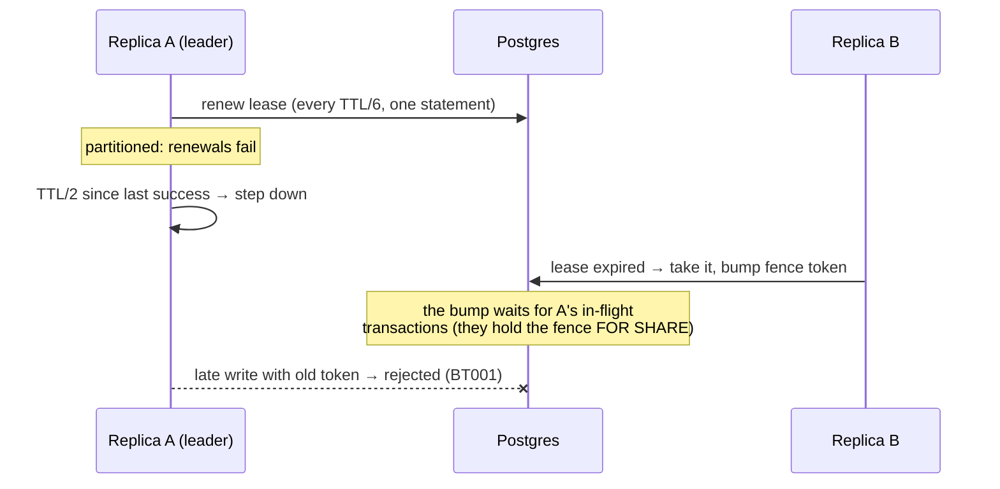
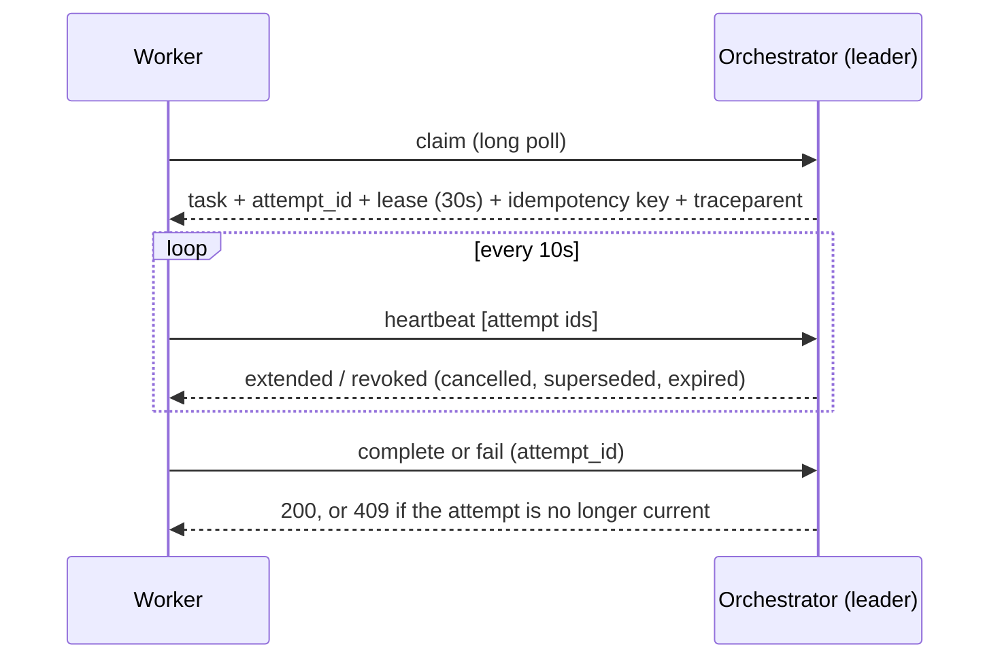

# Architecture

This document explains how Baton works and why it is built the way it is.
[SPEC.md](SPEC.md) is the precise contract, and each major decision has an
ADR in [docs/adr/](docs/adr/README.md). Here the aim is the shape of the
system, and the rules that keep it correct under failure.

## Components

| Binary | Role |
|---|---|
| `baton` | Orchestrator replica: REST API, worker protocol, and, on the leader only, the timer loops |
| `baton-worker` | Runs handlers; talks to the orchestrator over HTTP only and never touches the database |
| `batonctl` | CLI over the public REST API |

Inside `baton` (package `internal/...`):

```
server ─── HTTP routes; followers forward writes to the leader
  │
engine ─── worker protocol, workflow commands, DAG progression (progress),
  │         sagas, backpressure, outbox relay, reaper, retry timer
  │
state ──── the pure transition function Apply(snapshot, event)
store ──── transactions: fence check, Load (row lock), Append (events + projections)
leader ─── lease election, self-fencing watchdog
decision ─ Policy interface: RulePolicy, FallbackPolicy
laya ───── Laya on ONNX Runtime: tokenizer, input builder, calibration, session
telemetry  Prometheus metrics, OpenTelemetry tracing
```

## State: an event log with projections

Every state change of a workflow is one transaction that follows the same
steps (`store.Tx`):

1. **Check the fence.** Lock the fence row `FOR SHARE` and compare its token
   with this replica's, and check the lease is unexpired. The same query
   reads the database clock, which is the only clock used for decisions.
2. **Load.** `SELECT ... FOR UPDATE` the workflow row and read its tasks.
   This serializes all writers of one workflow and keeps its event sequence
   gapless.
3. **Decide.** The engine proposes events. For any task-level change,
   `progress` (the DAG engine) adds what follows from it: ready the steps
   whose dependencies succeeded, finish or fail the workflow, start or
   advance compensation. Apply them to a copy of the snapshot.
4. **Append.** Insert the events (a trigger checks each one's fencing token
   again) and upsert the changed `workflows`/`tasks` rows. Outbox messages
   go in the same transaction, and lease rows too.
5. **Commit.** In-process side effects (waking long-polling claimers,
   metrics) run only after the commit.

`state.Apply` is the only code that changes state. It is pure: no clock,
no randomness, no I/O. Random draws such as retry jitter, and decisions,
are stored in event payloads. So replaying a workflow's events through
`Apply` reproduces its rows column for column. The replay test, the chaos
suite and `chaos.Check` all verify this.

Some state is operational and not event-sourced: `task_leases` (heartbeats
move `lease_until` every few seconds) and `workers`. Their meaningful
transitions are events: claimed, expired, released, revoked.

## Rules for transactions and locks

These rules exist because breaking them caused real bugs during
development; the tests that caught each one are noted.

- **Lock order is workflow → task → lease.** The three paths that cannot
  follow it (claim, reaper, retry timer) find their rows with
  `FOR UPDATE ... SKIP LOCKED` on every table involved, so they never wait
  and cannot deadlock. Queue advisory locks (concurrency limits, admission)
  are taken in sorted queue order.
- **Never take a pool connection while holding a transaction.** If you do,
  a transaction holding a lock can wait for a connection that belongs to a
  transaction waiting for that lock. That cycle passes through the pool, so
  Postgres cannot see it. Definitions are read through the open
  transaction. (Found on a 4-CPU CI runner; `TestSmallPoolCannotDeadlock`
  reproduces it with a 2-connection pool.)
- **Never run inference inside a transaction.** Decisions are made before
  the transaction opens, under a deadline.
- **Lease renewal has its own connection pool and costs one round trip.**
  Under database latency, workload transactions hold every pooled
  connection, and a renewal waiting behind them misses its deadline. A
  multi-statement renewal outlasts it on its own. (Found by the chaos
  suite's latency scenario.)

## Leader election and fencing



- Two single-row tables: `leader_lease` (holder, expiry) and `leader_fence`
  (token). Renewals touch only the lease row. Only a takeover updates the
  fence row, and it waits for the old leader's in-flight transactions. In a
  first version the two were one row. Every write transaction holding it
  `FOR SHARE` then starved renewals, and a healthy leader stepped down under
  load (ADR 0002).
- The leader renews every TTL/6 with a TTL/3 deadline. It steps down on its
  own once its last successful renewal was sent TTL/2 ago, well before its
  lease can expire.
- A stale leader can still try to write, for example after a GC pause or a
  healed partition. It fails in the database: the fence check at the start
  of the transaction, and the trigger on every event insert. Every state
  change appends an event, so nothing a stale leader writes can commit. A
  fenced write also makes the replica step down at once.
- **Single writer.** Only the leader executes writes, and followers
  reverse-proxy them to it (ADR 0003). That makes rate limits and long-poll
  wakeups simple, and puts one writer behind every fencing argument. The
  price is that write throughput is one replica's.

## Workers, leases and delivery



- **Execution is at-least-once.** A worker can finish the work and die
  before reporting it. Leases expire, the reaper counts the attempt as used
  and schedules a retry, and a late result from the dead attempt gets 409.
  Handlers get effectively-once behaviour through the task's stable
  idempotency key ([docs/IDEMPOTENCY.md](docs/IDEMPOTENCY.md)).
- **Results are exactly-once per attempt.** A result is accepted only from
  the lease holder of the current, live, unrevoked attempt, and repeating an
  accepted report is a no-op.
- **Cancellation revokes leases** in the cancel transaction. The next
  heartbeat tells the worker to stop the handler, and nothing of that
  workflow is claimed or recorded afterwards. That is checked as an
  invariant after every chaos run.
- **Graceful worker shutdown.** On shutdown a worker stops claiming,
  finishes in-flight work while heartbeating, and releases what is left
  without using up attempts.

## Workflows and sagas

`progress` runs inside every transaction that changes a task, so the DAG
moves forward the moment a dependency succeeds; no scheduler polling is
needed.

- **Failure.** A workflow fails once a step is dead-lettered and nothing
  that could still run remains. Steps blocked by the failure are skipped.
- **Compensation.** If completed steps declare `compensate`, their
  compensations run one at a time, in reverse canonical topological order
  (Kahn's algorithm, ties broken by name, so the order is a pure function of
  the definition). A failed compensation stops the chain until someone
  retries it from the DLQ.
- **The `compensate` decision** fails the workflow at once and cancels
  in-flight siblings first.
- **Cancel with `compensate: true`** runs the same chain and ends
  `cancelled`.

## Backpressure

- **Concurrency limits** are enforced at claim time, under queue advisory
  locks, by counting running tasks.
- **Rate limits** are token buckets in leader memory, so a failover resets
  them.
- **Priority with aging.** Claims are ordered by `priority + wait/aging`, so
  old low-priority work cannot starve forever.
- **Admission control** counts a queue's backlog when a workflow is
  submitted, and rejects (429) or defers it. Deferred workflows are admitted
  oldest first as the queue drains.

## The decision layer

```
FallbackPolicy(primary = Laya or Rules, fallback = Rules, threshold, deadline)
```

- **Decision points.** Failure triage happens on `fail`. Priority
  classification happens at submission, for steps with a description but no
  explicit priority. Each decision is recorded as a `DecisionMade` event,
  with the input hash, label, confidence, policy, model revision, fallback
  reason and the primary's own answer. Replay reads decisions; it never
  re-runs a model.
- **Laya.** The model runs in-process on ONNX Runtime through cgo. It is a
  ModernBERT-large encoder with a decision head, pinned by revision and
  SHA-256 and verified on every load.
  - Baton has its own pure-Go tokenizer, because no Go library matched
    Hugging Face's token ids (ADR 0012). It matches on 23,000 strings.
  - The input builder and calibration are ported from `laya` 0.3.21 and
    match it to 1e-16.
  - It degrades safely: a missing model, a corrupt file, a timeout or low
    confidence all mean the rules answer, and the reason is recorded.
- **The rules are the default**, and the [eval](docs/EVAL.md) explains why.

## Observability

- **Traces.** A submission's trace context is stored in its first event and
  handed to the worker with every claim. The worker's `task.execute` span
  joins that trace, and its HTTP calls carry the span back, so one trace
  shows the submission, the decisions, every attempt and its result.
- **Metrics.** They live on an explicit registry and cover the brief's list
  (SPEC §11). Queue depth and outbox backlog are read from the database at
  scrape time.
- **Dashboard.** It is provisioned from `deploy/grafana/dashboards/baton.json`.

## How it is tested

| Layer | What |
|---|---|
| Unit | State machine (one test per transition, plus a property test over random histories), DAG validation, backoff, policies, tokenizer, input builder |
| Integration (real Postgres via testcontainers) | Store, engine, API, worker runner, leader election, multi-replica failover, tracing |
| Replay | Concurrent random workload, then rebuild every workflow from events and compare column by column |
| Concurrency | 16 workers, 300 tasks, crashes mid-task: never two attempts of one task in flight |
| Fencing | Stale and expired tokens rejected by the check and the trigger; a takeover waits for in-flight commits |
| Parity | Tokenizer vs Hugging Face (3,036 committed cases), sequences and probabilities vs `laya`'s own ONNX agent |
| Chaos (`make chaos`) | Real processes behind Toxiproxy: `kill -9` workers and leaders, a partitioned leader, 60±30ms latency, model faults; every invariant checked after each run |
| Eval and benchmarks | `tools/eval`, `tools/bench` |

Several tests were checked by planting the bug they target and confirming
that they fail.
