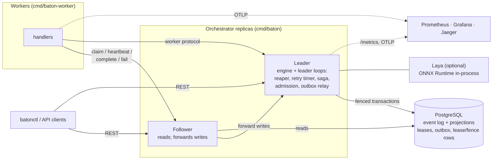

# Baton

Baton is a distributed task orchestrator written in Go. You submit
workflows as YAML DAGs. Baton schedules their steps on workers, retries
failures with backoff, compensates completed steps when a workflow fails
(sagas), and survives crashes of workers and orchestrators without losing
or double-running work. PostgreSQL is the only state.

- **Durable and replayable.** Every state change is an event in an
  append-only log, written in the same transaction as the tables it
  updates. Rebuilding state from the log reproduces the tables exactly, and
  tests check that after every run.
- **One leader, fenced in the database.** Replicas elect a leader through a
  Postgres lease with fencing tokens. A database trigger and a check at the
  start of every write transaction reject writes from a stale leader. Any
  replica accepts requests; followers forward writes to the leader.
- **At-least-once delivery, effectively-once results.** Workers claim tasks
  with `SELECT ... FOR UPDATE SKIP LOCKED` under heartbeated leases. Results
  are accepted only from the current attempt, and every task carries a
  stable idempotency key for handlers ([docs/IDEMPOTENCY.md](docs/IDEMPOTENCY.md)).
- **Backpressure.** Per-queue concurrency and rate limits, priority with
  aging, and admission control that rejects or defers submissions when a
  queue is too deep.
- **A decision layer with a safe default.** Failure triage (retry, back off,
  dead-letter, compensate, escalate) and priority classification go through
  one interface. The default is a deterministic rule policy. An optional
  in-process model, Laya on ONNX Runtime from Go, never blocks a request and
  falls back to the rules on error, timeout or low confidence. Its
  [evaluation](docs/EVAL.md) says to keep the rules.
- **Observable.** Prometheus metrics, OpenTelemetry traces from submission
  through the worker's execution, and a provisioned Grafana dashboard.

## Quickstart

Requirements: Docker with Compose, and Go 1.27 (for the CLI and tests).

```sh
docker compose up -d --build   # Postgres, 2 orchestrators, 3 workers, Toxiproxy, Prometheus, Grafana, Jaeger
go build -o bin/batonctl ./cmd/batonctl
export BATON_ADDR=http://localhost:8081

./bin/batonctl submit -f examples/order.yaml
./bin/batonctl list
./bin/batonctl status <workflow-id> --events
```

Or run the guided demo. It covers a DAG with a retry, a saga compensation,
the DLQ, and killing the leader mid-run:

```sh
scripts/demo.sh          # add --down to remove the stack afterwards
```

Grafana is at http://localhost:3000 (dashboard "Baton"), Jaeger at
http://localhost:16686, and Prometheus at http://localhost:9090.

## A workflow

```yaml
name: order-fulfilment
version: 1
queue: default
defaults:
  timeout: 30s
  retry: { max_attempts: 5, initial_backoff: 1s, max_backoff: 5m, multiplier: 2, jitter: full }
steps:
  - name: charge
    handler: payments.charge
    priority: 80
    input: { amount_cents: 1299 }
    compensate: { handler: payments.refund }
  - name: reserve
    handler: inventory.reserve
    depends_on: [charge]
    compensate: { handler: inventory.release }
  - name: ship
    handler: shipping.create
    depends_on: [charge, reserve]
    description: "Create the shipment"   # classified for priority when no priority is set
```

Definitions are validated on submission: strict keys, ranges, unknown
dependencies, and cycles, which are named in the error (`cycle: a -> b -> a`).
Every problem is reported at once. If `ship` fails for good, Baton
compensates `reserve` and then `charge`, one at a time and last first. See
[SPEC.md](SPEC.md) §2–3 for the full format and semantics.

## Writing a worker

Workers are separate processes that talk to the orchestrator's HTTP API
only. `baton-worker` ships demo handlers (`echo`, `sleep`, `flaky`). A real
worker wraps its own handlers in `worker.Runner`:

```go
handlers := map[string]worker.Handler{
	"payments.charge": func(ctx context.Context, t worker.Task) (json.RawMessage, error) {
		// t.IdempotencyKey is the same on every attempt: pass it downstream.
		if declined {
			return nil, worker.Permanent(errors.New("card declined")) // do not retry
		}
		return json.RawMessage(`{"charge_id":"ch_1"}`), nil
	},
}
r := worker.NewRunner(worker.NewClient([]string{"http://baton-1:8080", "http://baton-2:8080"}, nil),
	handlers, worker.Config{ID: "payments-1", Queues: []string{"default"}}, log)
r.Run(ctx) // drains on cancellation: finishes in-flight work, releases the rest
```

## CLI

```
batonctl submit -f FILE [--input JSON] [--priority N] [--idempotency-key K] [--callback URL]
batonctl status ID [--events]   |   batonctl list [--status S]
batonctl cancel ID [--compensate]   |   batonctl pause ID   |   batonctl resume ID
batonctl dlq list [--queue Q]   |   batonctl dlq retry TASK_ID
batonctl queues   |   batonctl queues set Q --max-concurrency N --rate R --burst B --max-depth D --admission reject|defer
```

The REST API is specified in [api/openapi.yaml](api/openapi.yaml).

## Architecture



[ARCHITECTURE.md](ARCHITECTURE.md) explains how the pieces fit, and
[SPEC.md](SPEC.md) is the normative contract. The decisions behind both are
recorded in [docs/adr/](docs/adr/README.md).

## Configuration

Everything is set through environment variables with defaults (SPEC §12).
The ones you are most likely to change:

| Variable | Default | |
|---|---|---|
| `BATON_DATABASE_URL` | (required) | Postgres URL |
| `BATON_HTTP_ADDR` / `BATON_ADVERTISE_ADDR` | `:8080` / `http://<replica-id>:8080` | listen address, and where other replicas reach this one |
| `BATON_LEADER_TTL` | `10s` | leader lease; failover takes about this long after a crash |
| `BATON_LEASE_TTL` / `BATON_HEARTBEAT_INTERVAL` | `30s` / `10s` | task leases |
| `BATON_DECISION_POLICY` | `rule` | `laya` enables the model (see `docker-compose.laya.yml`) |
| `BATON_ESCALATION_WEBHOOK` | | receives `escalate` decisions via the outbox |
| `OTEL_EXPORTER_OTLP_ENDPOINT` | | turns tracing on |
| `BATON_ADDR` (worker, CLI) | `http://localhost:8080` | comma-separated replicas for workers |

## Development

```sh
make check          # vet, lint, race tests including Postgres integration tests (Docker)
make chaos          # fault injection: kill -9 workers and leaders, partitions, latency, model faults
go run ./tools/eval # decision eval (needs the model: go run ./cmd/baton model fetch)
go run ./tools/bench
```

| Document | What it covers |
|---|---|
| [SPEC.md](SPEC.md) | State machines, schema, semantics, failure model, APIs, invariants |
| [ARCHITECTURE.md](ARCHITECTURE.md) | How it works and why it is built that way |
| [docs/adr/](docs/adr/README.md) | Architecture decision records |
| [docs/IDEMPOTENCY.md](docs/IDEMPOTENCY.md) | How handlers achieve effectively-once behaviour |
| [docs/EVAL.md](docs/EVAL.md) | Rule policy vs Laya on 204 labeled failures |
| [docs/BENCHMARKS.md](docs/BENCHMARKS.md) | Claim throughput and latency, decision latency |

## Status and limitations

Baton is complete against its specification and tested at every layer. It
is not battle-tested in production. Known limits:

- **Write throughput is one replica's.** All writes go through the leader.
  It plateaus around 450 claimed tasks per second on a laptop (see
  BENCHMARKS.md).
- **Latency sensitivity.** A claim is about 16 statements, so database
  latency multiplies quickly.
- **Rate limits live in leader memory.** They reset on failover, which can
  allow one extra burst.
- **The Laya model doesn't pay off for triage** at the pinned revision. It's
  less accurate than the rules, its confidence isn't informative, it costs
  about 0.8s and 1.4 GB per replica, and it is off by default. The rule
  policy itself retries unknown failures by default, which wastes attempts
  on failures that need compensation or a human.
- **High availability for Postgres** is the deployment's job.
- Callback and escalation URLs are not restricted, so treat them as trusted
  input.
