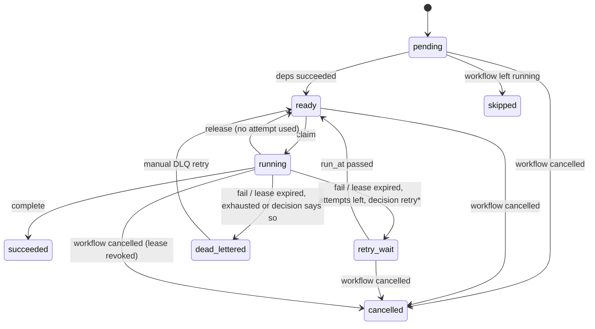

# Baton specification

Status: draft for review (Step 0). Module: `github.com/omer-ulucan/baton`.

This document is normative. "MUST", "MUST NOT", "SHOULD" and "MAY" follow
RFC 2119. Rationale for the major choices lives in `docs/adr/`; this document
states *what* the system guarantees, the ADRs state *why*.

---

## 1. Scope and terms

Baton runs DAG workflows of tasks on a fleet of workers, with PostgreSQL as
the only durable state.

| Term | Meaning |
|---|---|
| **Workflow definition** | A YAML document describing a DAG of steps. Immutable once submitted. |
| **Workflow** (instance) | One execution of a definition, identified by `workflow_id` (UUIDv7). |
| **Step** | A node of the DAG, identified by `name`, unique within a definition. |
| **Task** | The schedulable unit for one step of one workflow. One task per step, plus one task per compensation step that is actually run. |
| **Attempt** | One execution of a task by one worker, identified by `attempt_id` (UUIDv7). A task has 1..`max_attempts` attempts. |
| **Lease** | A time-bounded exclusive right of one worker to run one attempt. |
| **Leader** | The single orchestrator replica holding the leader lease. |
| **Fencing token** | A `bigint` that increases by at least 1 on every change of leader. |
| **Event** | An immutable row in `workflow_events`. The source of truth for workflow and task state. |
| **Projection** | The `workflows` and `tasks` tables, derived from events. |

Components:

- `baton` (orchestrator): HTTP API, worker protocol, and, on the leader only,
  the singleton loops (scheduler, lease reaper, retry timer, saga coordinator,
  outbox relay).
- `baton-worker`: runs handlers. Talks to the orchestrator HTTP API only and
  MUST NOT connect to PostgreSQL.
- `batonctl`: CLI over the public REST API.

---

## 2. Workflow definition (YAML)

```yaml
name: order-fulfilment            # required, [a-z0-9-]{1,63}
version: 3                        # required, positive integer
queue: default                    # default queue for steps
priority: 50                      # default priority 0..100, higher runs first
description: "Charge card, reserve stock, ship"   # optional, free text
defaults:
  timeout: 30s                    # per-attempt execution timeout
  retry:
    max_attempts: 5               # total attempts including the first, 1..100
    initial_backoff: 1s
    max_backoff: 5m
    multiplier: 2.0
    jitter: full                  # full | equal | none
steps:
  - name: charge-card             # required, [a-z0-9-]{1,63}, unique
    handler: payments.charge      # required, the worker-side handler name
    queue: payments               # optional, overrides definition queue
    priority: 80                  # optional
    description: "..."            # optional, free text, used for priority classification
    timeout: 10s                  # optional
    retry: { max_attempts: 3 }    # optional, merged over defaults
    input: { amount_cents: 1299 } # optional, opaque JSON object passed to the handler
    compensate:                   # optional
      handler: payments.refund
      timeout: 20s
      retry: { max_attempts: 10 }
  - name: reserve-stock
    handler: inventory.reserve
    depends_on: [charge-card]
  - name: ship
    handler: shipping.create
    depends_on: [charge-card, reserve-stock]
```

### 2.1 Validation (on submission, before anything is written)

A submission MUST be rejected with `422` and a list of all problems if any of
these hold:

1. YAML does not parse, or contains unknown keys (strict decoding).
2. A required field is missing or a field is outside its range.
3. Two steps share a name.
4. A `depends_on` entry names a step that does not exist.
5. A step depends on itself, or the graph has a cycle. The error names one
   cycle explicitly, e.g. `cycle: a -> b -> c -> a` (found by DFS with
   white/grey/black colouring; reported cycle is the first found in
   lexicographic step order, so errors are deterministic).
6. The definition has zero steps or more than 1,000 steps.
7. A duration does not parse with `time.ParseDuration`, or is `<= 0`.
8. Encoded `input` of any step exceeds 256 KiB.

The topological order used everywhere (scheduling ties, compensation order,
replay) is **Kahn's algorithm with ties broken by step name ascending**. It is
therefore a pure function of the definition.

### 2.2 Retry backoff

For a failed attempt number `n` (1-based) the base delay is
`d = min(max_backoff, initial_backoff * multiplier^(n-1))`. Jitter:

- `full`: uniform in `[0, d]`
- `equal`: `d/2 + uniform[0, d/2]`
- `none`: `d`

The random source is injected (no global RNG). The chosen delay is written
into the `TaskRetryScheduled` event, so replay never re-draws it.

---

## 3. State machines

All transitions happen inside a database transaction that appends the
corresponding event(s) and updates the projection (see section 5). Any
transition not listed here MUST be rejected (`409 Conflict` at the API, an
error inside the engine). The transition function is a pure Go function
`Apply(state, event) (state, error)` shared by the live path and replay.

### 3.1 Task states



| From | Event | To | Condition |
|---|---|---|---|
| `pending` | `TaskReady` | `ready` | all `depends_on` tasks are `succeeded` and workflow is `running` |
| `pending` | `TaskSkipped` | `skipped` | workflow left `running` for a terminal or compensating state |
| `ready` | `TaskClaimed` | `running` | workflow `running` (not paused), queue limits allow (section 9) |
| `running` | `TaskSucceeded` | `succeeded` | `attempt_id` matches current attempt, lease not expired |
| `running` | `TaskFailed` + `DecisionMade` + `TaskRetryScheduled` | `retry_wait` | attempts used `< max_attempts` and decision is `retry` or `retry_with_backoff` |
| `running` | `TaskFailed` + `DecisionMade` + `TaskDeadLettered` | `dead_lettered` | attempts exhausted, or decision is `dead_letter`, `compensate` or `escalate` |
| `running` | `TaskLeaseExpired` + (`TaskRetryScheduled` \| `TaskDeadLettered`) | `retry_wait` \| `dead_lettered` | reaper found `lease_until < now()`; counts as a used attempt |
| `running` | `TaskReleased` | `ready` | worker released voluntarily (graceful shutdown); does NOT count as an attempt |
| `retry_wait` | `TaskReady` | `ready` | `run_at <= now()`, workflow `running` |
| `ready`, `retry_wait`, `pending` | `TaskCancelled` | `cancelled` | workflow cancelled |
| `running` | `TaskCancelled` | `cancelled` | workflow cancelled; the attempt's lease is revoked (section 6.5) |
| `dead_lettered` | `TaskRequeued` | `ready` | manual DLQ retry; resets attempt counter to 0; workflow moves back to `running` |

Terminal task states: `succeeded`, `dead_lettered`, `cancelled`, `skipped`.
`dead_lettered` is terminal for scheduling but MAY be left by a manual DLQ
retry (the only transition out of a terminal state).

`TaskFailed` and `TaskLeaseExpired` end the attempt (clearing
`current_attempt` and `worker_id`) but leave the status `running`; they are
always followed, in the same transaction, by `TaskRetryScheduled` or
`TaskDeadLettered`, which are valid only on a `running` task with no
current attempt. The intermediate state is never visible outside the
transaction. `TaskReleased` returns the attempt (`attempt` decremented) and
keeps the original `ready_at`, so a released task does not lose its aging.

`retry` vs `retry_with_backoff`: `retry` schedules `run_at = now() + initial_backoff`
with no growth; `retry_with_backoff` uses section 2.2. Both still respect
`max_attempts`.

`escalate` dead-letters the task and additionally enqueues an `escalation`
outbox message (section 7). `compensate` dead-letters the task and fails the
workflow immediately without waiting for other running branches (they are
cancelled), which starts compensation.

### 3.2 Workflow states

| From | Event | To | Condition |
|---|---|---|---|
| (none) | `WorkflowSubmitted` | `running` | validation passed, admission control accepted |
| (none) | `WorkflowSubmitted` + `WorkflowDeferred` | `deferred` | admission control deferred (section 9.3) |
| `deferred` | `WorkflowAdmitted` | `running` | queue depth fell below the limit |
| `running` | `WorkflowPaused` | `paused` | API |
| `paused` | `WorkflowResumed` | `running` | API |
| `running` | `WorkflowSucceeded` | `succeeded` | every task is `succeeded` |
| `running` | `WorkflowFailed` | `failed` | some task `dead_lettered`, no task `running`/`ready`/`retry_wait`, and no completed step has a `compensate` step |
| `running` | `WorkflowFailed` + `CompensationStarted` | `compensating` | as above, but at least one `succeeded` step has `compensate` |
| `compensating` | `CompensationCompleted` | `compensated` | every compensation task `succeeded` |
| `compensating` | `CompensationFailed` | `compensation_failed` | some compensation task `dead_lettered` |
| `running`, `paused`, `deferred` | `WorkflowCancelRequested` + `WorkflowCancelled` | `cancelled` | API, `compensate: false`; all non-terminal tasks get `TaskCancelled` in the same transaction |
| `running`, `paused` | `WorkflowCancelRequested` + `CompensationStarted` | `compensating` | API, `compensate: true`; non-terminal step tasks get `TaskCancelled` in the same transaction |
| `compensating` | `WorkflowCancelled` | `cancelled` | compensation chain finished (either outcome) and the cancel request started it |
| `failed` | `WorkflowRetried` | `running` | manual DLQ retry of a step task of this workflow |
| `compensation_failed` | `WorkflowRetried` | `compensating` | manual DLQ retry of a compensation task; the chain resumes |

Terminal workflow states: `succeeded`, `failed`, `compensated`,
`compensation_failed`, `cancelled`. `failed` and `compensation_failed` may
be left only by a manual DLQ retry.

**Failure timing.** When a task is dead-lettered while siblings are still
running, the workflow stays `running` until those siblings finish (they may
succeed and become eligible for compensation). Exception: the `compensate`
decision fails the workflow immediately and cancels running siblings.

**Pause.** Pausing stops new claims of the workflow's tasks. Attempts already
running continue to completion and their results are recorded normally.
Retry timers keep firing but the task stays `retry_wait` until resume;
`TaskReady` is emitted on resume for every task whose `run_at` passed.

**Cancel.** Cancel is final; compensation is NOT run unless the request sets
`"compensate": true`, in which case the workflow passes through
`compensating` (3.3) and ends in `cancelled` regardless of compensation
outcome (the outcome is recorded in events and visible in status). Nothing
of a workflow is claimed after its `WorkflowCancelled` event.

### 3.3 Saga compensation

- Eligible steps: steps whose task is `succeeded` and which declare `compensate`.
- Order: reverse of the topological order from 2.1, restricted to eligible
  steps. Compensation runs **sequentially**: compensation task `k+1` becomes
  `ready` only when task `k` is `succeeded`.
- Each compensation task is a normal task (`kind = 'compensation'`) with its
  own retry policy, timeout, lease and idempotency key; it follows 3.1, but
  triage decisions for compensation tasks may only yield `retry`,
  `retry_with_backoff` or `dead_letter` (`compensate` and `escalate` map to
  `dead_letter` + escalation message).
- If any compensation task is dead-lettered, the workflow becomes
  `compensation_failed`; remaining compensations are not run and stay
  `pending` (unclaimable, since claims of compensation tasks require the
  workflow to be `compensating`). A manual DLQ retry resumes the chain from
  the dead-lettered task. Only a cancel-initiated chain skips its remaining
  compensations, because `cancelled` requires every task to be terminal.
- A manual DLQ retry of a step task in a `failed` workflow returns that
  workflow's `skipped` and `cancelled` step tasks to `pending` (in the
  `WorkflowRetried` event), so the rest of the DAG can run again.

---

## 4. Database schema (PostgreSQL 16)

Migrations live in `migrations/` (golang-migrate, `NNNNNN_name.up.sql` /
`.down.sql`). Timestamps are `timestamptz`. All `now()` decisions use the
database clock (`clock_timestamp()` where it matters mid-transaction); Go
process clocks are never used for lease or fencing decisions.

```sql
-- Leader election (section 6.1)
CREATE TABLE leader_lease (
  name          text PRIMARY KEY,               -- always 'leader'
  holder_id     text,                            -- replica id, NULL if never held
  holder_addr   text,                            -- advertised http address of holder
  fencing_token bigint NOT NULL DEFAULT 0,
  expires_at    timestamptz NOT NULL DEFAULT '-infinity'
);

-- Immutable definitions, deduplicated by content hash
CREATE TABLE workflow_definitions (
  id          uuid PRIMARY KEY,
  name        text NOT NULL,
  version     int  NOT NULL,
  sha256      bytea NOT NULL UNIQUE,              -- hash of canonical YAML bytes
  spec        jsonb NOT NULL,                     -- parsed, defaults applied
  created_at  timestamptz NOT NULL
);

-- Source of truth
CREATE TABLE workflow_events (
  id            bigserial PRIMARY KEY,            -- global order (informational)
  workflow_id   uuid NOT NULL,
  seq           int  NOT NULL,                    -- 1-based, gapless per workflow
  type          text NOT NULL,
  task_id       uuid,                             -- set for task-level events
  payload       jsonb NOT NULL,
  occurred_at   timestamptz NOT NULL,             -- DB time captured by the writer
  fencing_token bigint NOT NULL,
  UNIQUE (workflow_id, seq)
);
-- Append-only: UPDATE and DELETE are rejected by trigger.
-- Fencing:     BEFORE INSERT trigger, section 6.2 (migration added with
--              leader election in phase 5, together with leader_lease).

-- Projections (rebuildable from events)
CREATE TABLE workflows (
  id              uuid PRIMARY KEY,
  definition_id   uuid NOT NULL REFERENCES workflow_definitions(id),
  status          text NOT NULL,
  priority        int  NOT NULL,
  submit_key      text UNIQUE,                    -- client idempotency key
  cancel_requested bool NOT NULL DEFAULT false,   -- set by WorkflowCancelRequested
  last_seq        int  NOT NULL,                  -- seq of last applied event
  created_at      timestamptz NOT NULL,           -- = occurred_at of WorkflowSubmitted
  updated_at      timestamptz NOT NULL,           -- = occurred_at of last event
  finished_at     timestamptz
);

CREATE TABLE tasks (
  id              uuid PRIMARY KEY,
  workflow_id     uuid NOT NULL REFERENCES workflows(id),
  step_name       text NOT NULL,
  kind            text NOT NULL,                  -- 'step' | 'compensation'
  handler         text NOT NULL,
  queue           text NOT NULL,
  priority        int  NOT NULL,                  -- static priority 0..100
  status          text NOT NULL,
  attempt         int  NOT NULL DEFAULT 0,        -- attempts used
  max_attempts    int  NOT NULL,
  current_attempt uuid,                           -- attempt_id while running
  worker_id       text,                           -- holder while running
  run_at          timestamptz,                    -- for retry_wait
  ready_at        timestamptz,                    -- when it became ready (aging)
  idempotency_key text NOT NULL,
  last_error      text,
  updated_at      timestamptz NOT NULL,
  UNIQUE (workflow_id, step_name, kind)
);
CREATE INDEX tasks_claim_idx ON tasks (queue, priority DESC, ready_at)
  WHERE status = 'ready';
CREATE INDEX tasks_retry_idx ON tasks (run_at) WHERE status = 'retry_wait';

-- Operational state (NOT event-sourced, NOT part of replay comparison)
CREATE TABLE workers (
  id            text PRIMARY KEY,
  queues        text[] NOT NULL,
  handlers      text[] NOT NULL,
  registered_at timestamptz NOT NULL,
  last_seen_at  timestamptz NOT NULL
);

CREATE TABLE task_leases (
  task_id      uuid PRIMARY KEY REFERENCES tasks(id),
  attempt_id   uuid NOT NULL,
  worker_id    text NOT NULL,
  lease_until  timestamptz NOT NULL,
  revoked      bool NOT NULL DEFAULT false          -- set on cancel
);
CREATE INDEX task_leases_expiry_idx ON task_leases (lease_until);

CREATE TABLE queue_config (
  queue            text PRIMARY KEY,
  max_concurrency  int,                             -- NULL = unlimited
  rate_per_sec     double precision,                -- NULL = unlimited
  burst            int,
  max_depth        int,                             -- admission limit
  admission_mode   text NOT NULL DEFAULT 'reject'   -- 'reject' | 'defer'
);

CREATE TABLE outbox (
  id           bigserial PRIMARY KEY,
  topic        text NOT NULL,                       -- 'workflow.terminal' | 'escalation'
  key          text NOT NULL,                       -- dedupe key for consumers
  payload      jsonb NOT NULL,
  created_at   timestamptz NOT NULL,
  attempts     int NOT NULL DEFAULT 0,
  next_try_at  timestamptz NOT NULL,
  published_at timestamptz
);
CREATE INDEX outbox_pending_idx ON outbox (next_try_at) WHERE published_at IS NULL;
```

Rationale for splitting leases and workers out of the event log: heartbeats
are frequent, and logging each would multiply event volume for no
recoverable information. Lease *outcomes* (claim, expiry, release, revoke)
are events. See ADR 0004.

---

## 5. Event sourcing and replay

### 5.1 Write path

Every state change is one transaction:

1. `SELECT ... FROM workflows WHERE id = $1 FOR UPDATE` (serializes all
   writers of one workflow; `seq` allocation is `last_seq + 1`).
2. Load current task rows needed; compute new state with the pure
   `Apply` function.
3. `INSERT` the event(s) into `workflow_events` with the leader's fencing token.
4. `UPDATE` the projection rows, including `workflows.last_seq`.
5. Optionally `INSERT` into `outbox`.
6. `COMMIT`.

Projection columns MUST be computed only from event payloads and
`occurred_at`, never from `now()` at projection time, so replay reproduces
them byte for byte.

### 5.2 Event types

Workflow: `WorkflowSubmitted{definition_id, priority, input, submit_key}`,
`WorkflowDeferred`, `WorkflowAdmitted`, `WorkflowPaused`, `WorkflowResumed`,
`WorkflowCancelRequested{compensate, reason}`, `WorkflowCancelled`,
`WorkflowSucceeded`, `WorkflowFailed{cause_task_id}`, `WorkflowRetried`,
`CompensationStarted{order: [step...]}`, `CompensationCompleted`,
`CompensationFailed`.

Task: `TaskCreated{step, kind, handler, queue, priority, max_attempts, idempotency_key}`,
`TaskReady`, `TaskClaimed{attempt_id, worker_id, attempt}`,
`TaskSucceeded{attempt_id, output_digest}`,
`TaskFailed{attempt_id, error_class, message, stack_digest}`,
`TaskLeaseExpired{attempt_id}`, `TaskReleased{attempt_id}`,
`TaskRetryScheduled{run_at, delay_ms}`, `TaskDeadLettered{reason}`,
`TaskRequeued{by}`, `TaskCancelled`, `TaskSkipped`.

Decision: `DecisionMade` (section 10.5).

Payload schemas are versioned with a `"v": 1` field; the projector MUST
reject unknown versions.

### 5.3 Replay

`Replay(events) -> (workflows, tasks)` folds events ordered by
`(workflow_id, seq)` through `Apply` into empty in-memory projections.

**Determinism requirements.**
- `Apply` has no access to clocks, RNG, network, or the model.
- Random choices (jitter) and decisions are read from event payloads.
- `DecisionMade` is applied from history; replay MUST NOT invoke any
  `DecisionPolicy`.

**Replay test (phase 2, extended in later phases).** Run a generated
workload (many workflows with random DAGs, failures, retries, cancels)
against real Postgres; then rebuild projections from `workflow_events` and
assert equality with the `workflows` and `tasks` tables column by column,
for every row. The chaos suite runs the same check as an invariant.

Snapshots are out of scope; replay of one workflow is O(events of that workflow).

---

## 6. Control plane: leader election and fencing

### 6.1 Lease protocol

Parameters: `BATON_LEADER_TTL` (default 10s), renew every TTL/3, a replica
that fails to renew within TTL/2 of its last success MUST stop all leader
loops and stop accepting writes before its lease could expire.

Acquire or renew (one statement, DB clock):

```sql
UPDATE leader_lease
   SET holder_id     = $me,
       holder_addr   = $addr,
       fencing_token = CASE WHEN holder_id = $me AND expires_at > clock_timestamp()
                            THEN fencing_token ELSE fencing_token + 1 END,
       expires_at    = clock_timestamp() + $ttl
 WHERE name = 'leader'
   AND (holder_id = $me OR expires_at <= clock_timestamp())
RETURNING fencing_token;
```

No row returned means another replica leads. A replica that renews after its
own lease expired gets a new token, and MUST treat that as a new term
(restart loops, rebuild in-memory caches). Voluntary step-down on SIGTERM
sets `expires_at = '-infinity'` for a fast handover.

### 6.2 Fencing at the database level

Every insert into `workflow_events` carries `fencing_token`. A
`BEFORE INSERT` trigger rejects it unless it equals the current token and
the lease is unexpired:

```sql
SELECT fencing_token, expires_at INTO cur_token, cur_exp
  FROM leader_lease WHERE name = 'leader' FOR SHARE;
IF NEW.fencing_token <> cur_token OR cur_exp <= clock_timestamp() THEN
  RAISE EXCEPTION 'stale fencing token % (current %)', NEW.fencing_token, cur_token
    USING ERRCODE = 'BT001';
END IF;
```

`FOR SHARE` on the lease row conflicts with the takeover `UPDATE`, so a
takeover waits for in-flight leader transactions to finish and, once it
commits, every later insert from the old leader fails. Because every state
change appends an event in the same transaction (5.1), **no projection,
outbox or lease write by a stale leader can commit**. Writes to
`task_leases` and `outbox` happen only in transactions that also insert an
event, except heartbeat extension, which uses
`UPDATE task_leases ... WHERE ... AND (SELECT fencing_token FROM leader_lease FOR SHARE) = $token`
for the same guarantee. Error `BT001` makes the replica step down
immediately.

### 6.3 Single writer

All writes (submission, cancel, pause, resume, DLQ, worker protocol) are
executed by the leader. A follower receiving a write request reverse-proxies
it to `leader_lease.holder_addr`; if there is no live leader it returns
`503` with `Retry-After: 1`. Followers serve all read endpoints directly from
the database. Clients and workers may therefore talk to any replica. See ADR
0003.

### 6.4 Leader loops

| Loop | Period | Work |
|---|---|---|
| Scheduler | event-driven + 1s tick | promote `pending` -> `ready` when dependencies are met (normally done inline on completion; the tick is a safety net), admit `deferred` workflows |
| Lease reaper | 1s | for each `task_leases.lease_until < clock_timestamp()`: `TaskLeaseExpired` + retry or DLQ |
| Retry timer | 500ms | `retry_wait` with `run_at <= now()` -> `TaskReady` |
| Saga coordinator | event-driven + 1s tick | start and advance compensation chains |
| Outbox relay | 500ms | publish pending outbox rows (section 7) |

Each loop batches at most `BATON_LOOP_BATCH` (default 100) items per
iteration and uses `FOR UPDATE SKIP LOCKED` on the rows it handles, so loops
never block API transactions for long.

### 6.5 Failure model

| Failure | Behaviour |
|---|---|
| Worker crash (incl. `kill -9`) | Its leases expire; reaper emits `TaskLeaseExpired`; task retries per policy. Late results from that attempt are rejected (`409`, `attempt_superseded`). |
| Worker network partition | Same as crash from the orchestrator's view. The worker discovers on its next heartbeat (`409`) and MUST abandon the attempt. |
| Leader crash | Lease expires within TTL; a follower acquires with token+1 and starts loops. In-flight HTTP writes on the dead leader either committed or did not; clients retry with idempotency keys. |
| Leader partitioned from DB | It stops renewing; after TTL/2 it stops writing on its own; any write it still attempts fails the fencing trigger after takeover. |
| Leader partitioned from workers only | Workers' requests via other replicas are proxied to the leader; if a replica cannot reach the leader it returns `503` and workers back off. |
| PostgreSQL down | All writes fail; no state is lost (only committed state exists). Replicas keep retrying with backoff. Reads fail. |
| Postgres slow (Toxiproxy latency) | Lease TTL must exceed worst expected renew round trip; renew failures cause step-down rather than split brain. |
| Model missing or corrupt, inference error or timeout | Decision layer falls back to `RulePolicy` (section 10). Never fails a request. |
| Clock skew between replicas | Irrelevant to correctness: all lease and fencing checks use the DB clock. |

Out of scope: PostgreSQL HA and failover (assumed to be provided by the
deployment), Byzantine actors, multi-region.

**Cancel and running attempts.** `WorkflowCancelled` sets
`task_leases.revoked = true` for the workflow's running attempts in the same
transaction. The next heartbeat of such an attempt returns `409 cancelled`;
the worker MUST cancel the handler's context. Any later complete/fail for
that attempt is acknowledged with `409` and does not change state.

**Invariant "no step runs after cancel"** is defined as: in each
workflow's event stream, no `TaskClaimed` has a `seq` greater than the
`WorkflowCancelled` event's `seq`, and every `TaskSucceeded`/`TaskFailed`
after it is absent (late results are rejected, not recorded). An attempt
already executing on a worker may continue until its next heartbeat (bounded
by the heartbeat interval); this is the honest limit of what an orchestrator
can enforce on remote code.

---

## 7. Delivery semantics

- **Execution: at-least-once.** An attempt may run more than once in effect
  (a worker may finish the work and crash before reporting). Baton never
  promises exactly-once execution.
- **Result recording: exactly-once per attempt.** A result is accepted only if
  `attempt_id` equals `tasks.current_attempt`, the task is `running`, and the
  lease is not revoked. Duplicate reports of the same accepted result are
  idempotent (`200` with the same response); conflicting ones get `409`.
- **Idempotency key.** Each task carries
  `idempotency_key = "<workflow_id>/<step_name>/<kind>"`, stable across all
  attempts. Handlers achieve effectively-once side effects by (a) passing the
  key to downstream APIs that support idempotency keys (payment providers,
  etc.), or (b) recording `idempotency_key` in their own store in the same
  transaction as the side effect, with a unique constraint, and treating a
  conflict as success. `docs/IDEMPOTENCY.md` documents both patterns with
  code, and the worker SDK exposes the key on the task context.
- **Submission idempotency.** `POST /v1/workflows` accepts an
  `Idempotency-Key` header stored in `workflows.submit_key`; a repeat
  returns the original workflow (`200` instead of `201`).
- **Outbox (at-least-once publish).** Side effects leaving the DB
  (`workflow.terminal` webhooks to a submission's optional `callback_url`,
  `escalation` messages to `BATON_ESCALATION_WEBHOOK`) are written to
  `outbox` in the state-change transaction. The relay POSTs each message with
  header `Baton-Message-Key: <key>`, marks `published_at` on 2xx, otherwise
  retries with exponential backoff up to 24h, then marks it failed and logs.
  Consumers dedupe on the key.

---

## 8. APIs

JSON over HTTP. Full schema in `api/openapi.yaml` (OpenAPI 3.1), which is the
contract; this section is a summary. Errors use
`{"error": {"code": "snake_case", "message": "...", "details": {...}}}`.
Handlers receive the workflow input with the step's `input` merged over it
(shallow, step keys win); both must be JSON objects.
All endpoints accept and propagate W3C `traceparent`.

### 8.1 Public API (`/v1`)

| Method & path | Purpose | Success | Notable errors |
|---|---|---|---|
| `POST /v1/workflows` | Submit. Body: `{"definition": "<yaml>", "input": {...}, "priority": 50?, "callback_url": "..."?}`; header `Idempotency-Key` optional | `201` `{workflow_id, status}` (`202` if deferred) | `422 invalid_definition`, `429 queue_full` with `Retry-After` |
| `GET /v1/workflows/{id}` | Status with tasks | `200` | `404` |
| `GET /v1/workflows?status=&limit=&cursor=` | List, keyset-paginated | `200` | |
| `GET /v1/workflows/{id}/events?after_seq=` | Event history | `200` | |
| `POST /v1/workflows/{id}/cancel` | Body `{"compensate": false, "reason": ""}` | `200` | `409 invalid_transition` |
| `POST /v1/workflows/{id}/pause` | | `200` | `409` |
| `POST /v1/workflows/{id}/resume` | | `200` | `409` |
| `GET /v1/dlq?queue=&limit=&cursor=` | Dead-lettered tasks with last error and last decision | `200` | |
| `POST /v1/dlq/{task_id}/retry` | Manual retry; optional `Baton-Actor` header is recorded in `TaskRequeued.by` | `200` | `409 invalid_transition` |
| `GET /v1/queues` | Depth, running, limits per queue | `200` | |
| `PUT /v1/queues/{queue}` | Set `queue_config` | `200` | `422` |
| `GET /healthz` | Liveness | `200` | |
| `GET /readyz` | Ready (DB reachable; reports `role: leader|follower`) | `200` | `503` |
| `GET /metrics` | Prometheus | `200` | |

### 8.2 Worker protocol (`/v1/worker`)

| Method & path | Request | Response |
|---|---|---|
| `POST /register` | `{worker_id, queues[], handlers[], version}` | `200 {heartbeat_interval_ms, lease_ttl_ms}` |
| `POST /claim` | `{worker_id, queues[], max: 1..32, wait_ms: 0..30000}` | `200 {tasks: [{task_id, attempt_id, workflow_id, step, handler, input, idempotency_key, attempt, deadline, lease_until}]}`; long-polls up to `wait_ms` when empty |
| `POST /heartbeat` | `{worker_id, attempts: [attempt_id...]}` | `200 {extended: [{attempt_id, lease_until}], revoked: [{attempt_id, reason}]}` (`reason`: `cancelled` \| `superseded` \| `expired`) |
| `POST /complete` | `{worker_id, task_id, attempt_id, output: {...}}` | `200` \| `409 attempt_superseded` \| `409 cancelled` |
| `POST /fail` | `{worker_id, task_id, attempt_id, error: {message, type?, stack?, retryable?}}` | `200 {next: "retry" | "dead_letter" | ...}` \| `409` |
| `POST /release` | `{worker_id, attempt_ids[]}` | `200` |

Claim is one transaction:

```sql
SELECT t.id FROM tasks t
  JOIN workflows w ON w.id = t.workflow_id
 WHERE t.status = 'ready' AND t.queue = ANY($queues) AND t.handler = ANY($handlers)
   AND w.status = 'running'
 ORDER BY effective_priority DESC, t.ready_at, t.id
 LIMIT $n
 FOR UPDATE OF t SKIP LOCKED;
```

followed by per-queue limit checks (section 9), `TaskClaimed` events, and
`task_leases` inserts. The claim locks task and workflow rows with
`FOR UPDATE OF t, w SKIP LOCKED`: every other writer locks workflow before
task before lease, and the claim, reaper and retry-timer queries, which
take them in another order, never wait, so writers cannot deadlock.

Results carry `task_id` as well as `attempt_id` so the orchestrator can lock
the task's workflow first (lock order) before checking the lease. Results
are accepted only from the worker holding the current attempt's live,
unrevoked lease; heartbeats never revive an expired lease. Worker-supplied
text is stripped of NUL bytes and invalid UTF-8 before it is stored. Lease TTL default 30s, heartbeat interval default 10s
(both env-configurable, `lease_ttl >= 3 * heartbeat_interval` enforced at
startup).

**Worker shutdown on SIGTERM**: stop claiming; wait up to
`BATON_WORKER_DRAIN_TIMEOUT` (default 25s) for in-flight handlers while
heartbeating; `release` whatever is still running; exit. A second SIGTERM or
SIGINT releases immediately.

### 8.3 CLI

`batonctl submit -f wf.yaml [--input json] [--idempotency-key k]`,
`batonctl status <id> [--events]`, `batonctl list [--status s]`,
`batonctl cancel <id> [--compensate]`, `batonctl pause|resume <id>`,
`batonctl dlq list [--queue q]`, `batonctl dlq retry <task_id>`,
`batonctl queues [set <q> --max-concurrency n ...]`. Global flags:
`--server` (env `BATON_ADDR`), `--output table|json`.

---

## 9. Backpressure and fairness

### 9.1 Per-queue limits (enforced at claim)

- **Concurrency:** count of `running` tasks in the queue, read under a
  per-queue advisory transaction lock (`pg_advisory_xact_lock(hashtext(queue))`)
  so concurrent claims cannot overshoot `max_concurrency`.
- **Rate:** token bucket per queue held in leader memory (`rate_per_sec`,
  `burst`). Leader-only, so a single bucket exists; it resets on failover,
  which can briefly allow up to one extra burst. Documented limitation.

### 9.2 Priority with aging

`effective_priority = priority + floor(extract(epoch from now() - ready_at) / BATON_AGING_SECONDS)`,
capped at 200. Default `BATON_AGING_SECONDS = 30`: a priority-0 task outranks
a fresh priority-100 task after 50 minutes at most. Ties: oldest `ready_at`,
then `id`.

### 9.3 Admission control

On submission, the leader computes the depth of each queue the workflow
touches (`ready + retry_wait + pending` tasks). If any exceeds
`queue_config.max_depth`:
- `admission_mode = reject`: `429 queue_full` with `Retry-After`.
- `admission_mode = defer`: workflow is recorded as `deferred` (`202`), and
  the scheduler admits deferred workflows FIFO as depth falls.

---

## 10. Decision layer contract

### 10.1 Interface (package `internal/decision`)

```go
type Kind string // "triage" | "priority"

type Request struct {
    Kind    Kind
    TaskID  uuid.UUID
    // triage
    ErrorMessage string
    ErrorType    string
    Stack        string // truncated to 4 KiB, most recent frames kept
    Attempt      int
    MaxAttempts  int
    Retryable    *bool  // worker hint, may be nil
    // priority
    Description  string
}

type Decision struct {
    Label         string  // triage: retry|retry_with_backoff|dead_letter|compensate|escalate
                          // priority: low|normal|high|critical
    Confidence    float64 // [0,1]
    Policy        string  // "rule" | "laya"
    ModelRevision string  // empty for rule
    InputHash     string  // hex sha256 of the canonical encoding of Request
    Fallback      string  // "" | "low_confidence" | "timeout" | "error" | "unavailable"
}

// decision.Policy; called DecisionPolicy elsewhere in this document.
type Policy interface {
    Decide(ctx context.Context, req Request) (Decision, error)
}
```

- `RulePolicy`: deterministic, table-driven (error type and regex rules,
  worker `retryable` hint, attempt counts; keyword rules for priority). Never
  errors; confidence is the matched rule's configured confidence (1.0 for the
  default rule). Always available; default when `BATON_DECISION_POLICY=rule`.
- `LayaPolicy`: ONNX inference (10.3).
- `FallbackPolicy{Primary, Fallback, Threshold, Timeout}`: the policy the
  engine uses. Calls `Primary` with `context.WithTimeout(Timeout)`; on error,
  timeout, or `Confidence < Threshold` it returns `Fallback`'s decision with
  `Fallback` set to the reason. Defaults: threshold `0.5`, timeout `1500ms`
  for triage, `500ms` for priority (both env-configurable).

Priority mapping: `low=20, normal=50, high=80, critical=95`. Classification
applies only to steps that have a `description` and no explicit `priority`.

### 10.2 Critical-path guarantee

- Decisions are computed **before** opening the state-change transaction; no
  transaction or row lock is ever held across inference.
- The claim path, the lease reaper, the retry timer and leader renewal never
  call a policy.
- Inference concurrency is bounded by a semaphore (`BATON_LAYA_MAX_INFLIGHT`,
  default 2 batches). Acquisition respects the request context, so a
  saturated model turns into a timeout and a fallback, not a queue.
- The worst-case added latency on `POST /fail` and `POST /v1/workflows` is the
  configured timeout. The ONNX `Run` call cannot be interrupted; a timed-out
  run finishes in the background and its result is discarded.

### 10.3 Laya model contract (verified against the model card at revision pin)

Source: `onnx-community/laya-ONNX`, revision
`42e2a6e3b3708c8ff5f61f4aa75c314b1449199b` (ONNX conversion of
`convaiinnovations/laya`: ModernBERT-large encoder + decision head, Apache-2.0).

Files and expected SHA-256 (from the Hub LFS metadata; re-verified on first
download in phase 7, and non-LFS file hashes pinned then):

| File | Size | SHA-256 |
|---|---|---|
| `onnx/model.onnx` | 4,442,939 | `04ac226b2ce6cfd35a28e8cefcc897e9fcc2901b0bfa86d0f518d5b94491f7b0` |
| `onnx/model.onnx_data` | 1,685,175,296 | `afcc11e72b59193fbec6e5dc8b693c9baa81cf66bec53279cefd687b318c3199` |
| `onnx/model_fp16.onnx` | 4,466,054 | `027403a80579f1546bac9831383c00ab9469a4e7c37aa8f68fdcecd85f8ef29e` |
| `onnx/model_fp16.onnx_data` | 842,587,136 | `6631bd51ee258787336568fda528ae3534fb5a3e13386558e7502043cbff4828` |
| `tokenizer.json`, `config.json` | small | pinned in phase 7 |

Graph I/O per the model card (MUST be re-checked by inspecting the graph
before writing inference code):

- Inputs: `input_ids [b,s] int64`, `attention_mask [b,s] int64`,
  `marker_pos [b,k] int64`, `marker_mask [b,k] bool`, `qtype [b] int64`
  (`choice=0, score=1, noul=2`).
- Outputs: `logits [b,k] float32` (one per option marker; masked slots
  `-1e4`), `act_logits [b,2]` (unused by Baton).

Sequence layout, one sequence per question:
`[CLS] {type} question: {question} [SEP] [MASK] opt1 [MASK] opt2 … [SEP] state [SEP]`,
with `max_len = 512`, `head_max_len = 192`, `max_option_tokens = 48`, read
from `config.json`'s `laya` section, not hard-coded. The exact Go port of
`laya.common.build_sequence` is specified by the Python source at the pinned
`laya` package version, which phase 7 pins and cites.

Calibration: `p = softmax(logits[valid] / T)` where `T` comes from
`temperature_by_options` keyed `"{type}:{bucket}"` (`2`, `3-5`, `6-10`,
`11+`), falling back to `temperature[qtype]`, clamped to
`temperature_clamp`. For `noul`, the two markers are false/true.

Baton's questions:
- Triage: `choice` with 5 options (`retry`, `retry_with_backoff`,
  `dead_letter`, `compensate`, `escalate`), each with a one-line criterion;
  state = canonical text of error type, message, truncated stack, attempt
  `n/max`, step handler.
- Priority: `score` with options `low`, `normal`, `high`, `critical`;
  state = the step description.

`Confidence = max(p)`, `Label = argmax(p)`.

Runtime: `onnxruntime_go` (cgo) with `libonnxruntime.so` (version pinned in
phase 7); one session per process, created lazily at startup in the
background; requests are micro-batched (max batch 8, max wait 5ms, padded
to the longest sequence in the batch). If loading fails (missing or corrupt
model, checksum mismatch, missing library) the policy reports `unavailable`
and every decision falls back; the orchestrator keeps running and exposes
`baton_decision_model_loaded 0`.

Tokenizer: must load `tokenizer.json` and reproduce the reference token ids
exactly on the parity fixtures. A pure-Go library is required; if none
matches, work stops for a decision (no cgo tokenizer without approval).

Parity: `tools/parity/` (Python, offline only) writes fixtures to
`internal/laya/testdata/`: token ids, marker positions, and probabilities.
Go MUST match ids and markers exactly and probabilities within `1e-4`
(fp32 model).

### 10.4 Model distribution

Downloaded on first start to `BATON_MODEL_DIR` (default
`$XDG_CACHE_HOME/baton/models/<revision>`), written to a temp file, hashed,
and renamed into place only if the SHA-256 matches. The orchestrator Docker
image bakes the model in a dedicated build stage with the same verification.
Variant selected by `BATON_LAYA_VARIANT=fp32|fp16` (default `fp32` on CPU,
see ADR 0008). Model files are never committed.

### 10.5 `DecisionMade` event

```json
{"v": 1, "kind": "triage", "task_id": "...", "attempt_id": "...",
 "input_hash": "<sha256 hex>", "label": "retry_with_backoff",
 "confidence": 0.71, "policy": "laya", "model_revision": "42e2a6e…",
 "fallback": "", "primary": {"policy": "laya", "label": "...", "confidence": 0.31},
 "latency_ms": 212}
```

`primary` is present when a fallback occurred, so the eval can measure what
the model would have done. The event is written in the same transaction as
the transition it drives. Replay applies `label` from the event; the model
is never run during replay.

---

## 11. Observability

- **Tracing** (OpenTelemetry, OTLP exporter, `OTEL_*` env vars): spans for
  submission, each transaction, claim, worker execution (worker-side span
  linked via `traceparent` stored in `TaskCreated`), complete/fail, decision
  (`decision.policy`, `decision.label`, `decision.fallback` attributes).
- **Metrics** (Prometheus, prefix `baton_`): `queue_depth{queue,status}`,
  `claim_latency_seconds`, `task_duration_seconds{queue,outcome}`,
  `task_retries_total{queue}`, `lease_expirations_total{queue}`,
  `leader_changes_total`, `is_leader`, `decision_latency_seconds{kind,policy}`,
  `decision_fallback_total{kind,reason}`, `decision_model_loaded`,
  `fencing_rejections_total`, `outbox_pending`.
- **Logging**: `log/slog` JSON, with `workflow_id`, `task_id`, `attempt_id`,
  `trace_id` attributes.
- Grafana dashboard JSON provisioned from `deploy/grafana/`.

---

## 12. Configuration

Env vars with defaults, no global state; parsed once into a `Config` struct
passed explicitly. Principal ones: `BATON_DATABASE_URL`, `BATON_HTTP_ADDR`
(`:8080`), `BATON_ADVERTISE_ADDR`, `BATON_REPLICA_ID` (default hostname),
`BATON_LEADER_TTL` (10s), `BATON_LEASE_TTL` (30s),
`BATON_HEARTBEAT_INTERVAL` (10s), `BATON_AGING_SECONDS` (30),
`BATON_DECISION_POLICY` (`rule` | `laya`, default `rule`),
`BATON_DECISION_THRESHOLD` (0.5), `BATON_MODEL_DIR`, `BATON_LAYA_VARIANT`,
`BATON_LAYA_MAX_INFLIGHT`, `ONNXRUNTIME_LIB_PATH`. Worker:
`BATON_ADDR`, `BATON_WORKER_ID`, `BATON_WORKER_QUEUES`,
`BATON_WORKER_CONCURRENCY`, `BATON_WORKER_DRAIN_TIMEOUT`.

---

## 13. Invariants (checked by tests and after every chaos run)

1. **No double claim:** at no point do two unexpired, unrevoked leases exist
   for the same task (`task_leases.task_id` is the primary key; the
   concurrency test also checks the event stream: no two `TaskClaimed` for a
   task without a terminating event between them).
2. **Termination:** with workers available and finite retry policies,
   every workflow reaches a terminal state.
3. **No run after cancel:** as defined in 6.5.
4. **Replay equality:** replayed projections equal materialized ones.
5. **Fencing:** no event in `workflow_events` carries a token lower than an
   earlier event's token by `id` order (tokens are non-decreasing in commit
   order), and every injected stale write is rejected.
6. **Gapless history:** `seq` is `1..last_seq` for every workflow.
7. **Attempts bounded:** `attempt <= max_attempts` for every task (DLQ
   requeue resets the counter and is recorded).

---

## 14. Known risks and open questions

1. **Model quality.** The model card reports 36.4% overall accuracy
   (zero-shot, fp32) on its typed-decisions benchmark. Triage on error
   messages is out of its training distribution. `LayaPolicy` may well lose to
   `RulePolicy`; the default policy is `rule` and the eval (phase 10) decides
   whether `laya` is recommended. EVAL.md will report this honestly either way.
2. **No int8 export upstream.** Revision `42e2a6e` ships fp32 and fp16 only.
   fp16 on CPU ONNX Runtime is often *slower* than fp32. An int8 variant
   would have to be produced by us with ONNX Runtime dynamic quantization in
   an offline tool and hosted somewhere we control. Decision needed in phase 7.
3. **Model size and CPU latency.** 1.69 GB fp32 (ModernBERT-large, ~395M
   parameters). Expect hundreds of milliseconds per triage on CPU; the image
   grows accordingly. Fallback timeouts are sized for this.
4. **Tokenizer.** ModernBERT uses a byte-level BPE `tokenizer.json`; a pure-Go
   implementation with exact parity is not guaranteed to exist. Phase 7 stops
   for a decision if none matches.
5. **Rate limiter state** is leader-memory only (9.1).
6. **Single writer** caps write throughput at one replica (ADR 0003).
